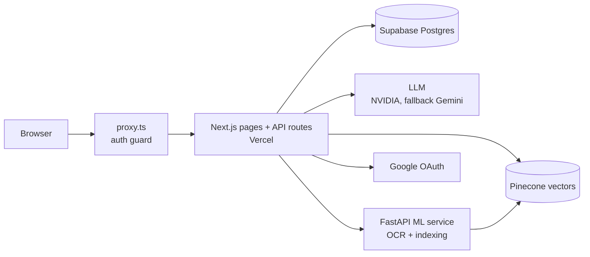

# Orvelo

> Your whole semester, in one orbit.

[](https://github.com/Sahil-coder-30/btech-hub/actions/workflows/ci.yml)

An AI study platform for AKTU engineering students. Find material for your exact branch and semester,
ask questions answered from the official syllabus, solve doubts from a photo, practice quizzes,
build an exam plan, and track SGPA and CGPA.

**Stack:** Next.js 16 (App Router) · React 19 · TypeScript · Tailwind CSS 4 · Supabase Postgres ·
Pinecone · LangChain · NVIDIA / Gemini models · Vercel

## Contents

- [Features](#features)
- [Architecture](#architecture)
- [Getting started](#getting-started)
- [Environment variables](#environment-variables)
- [Scripts](#scripts)
- [Testing](#testing)
- [CI/CD](#cicd)
- [Project structure](#project-structure)
- [Docs](#docs)

## Features

| Feature | What it does | Page |
|---|---|---|
| Ask your Syllabus | Chat with the official AKTU syllabus PDF. Streamed answers with source pages. | `/ask` |
| Vac agent | Study assistant with 14 tools (syllabus, material search, SGPA, quiz, plans, memory). | `/vac` |
| Doubt solver | Text or photo of a question, get a worked answer. | `/doubt` |
| Quiz | 3 to 15 MCQs per subject and unit, with weak-topic analysis. | `/quiz` |
| Study planner | Deterministic exam schedule. AI writes only the topics. | `/planner` |
| SGPA / CGPA | AKTU grade scale, target CGPA planner, percentage conversion. | `/sgpa`, `/cgpa` |
| Resources | Notes, PYQs, lectures by year, semester, branch. Save and search. | `/resources` |
| Uploads | Students share notes. Admin reviews, approved files get indexed. | `/upload` |
| Onboarding | Reads your AKTU One View result PDF to fill your profile. | `/onboarding` |
| Admin | Stats, resources, documents, uploads, syllabus indexing. | `/admin` |
| Privacy | Export all data, delete account, clear chat history. | `/settings` |

## Architecture



| Piece | Where | Notes |
|---|---|---|
| Auth guard | `src/proxy.ts` | Guest, login, admin, and onboarding redirects for pages |
| API | `src/app/api/**/route.ts` | Each route checks the session itself |
| Google OAuth | `src/pages/api/auth/google` | Passport.js, then a signed `bh_session` cookie |
| Session | `src/lib/session.ts` | HS256 JWT, HttpOnly, 7 days |
| AI | `src/lib/ai` | Model wrappers, RAG, agent tools, syllabus chat |
| Planner | `src/lib/planner` | Pure scheduler plus AI topic writer |
| DB schema | `supabase/schema.sql`, `supabase/migrations` | 21 tables |
| ML service | separate repo | Set `ML_SERVICE_URL`. The app falls back to local PDF parsing when it is down. |

## Getting started

**Needs:** Node.js 22.18 or newer, npm, a Supabase project, a Pinecone index (1024 dims, cosine),
a Google OAuth client, and an NVIDIA or Gemini API key.

```bash
git clone https://github.com/Sahil-coder-30/btech-hub.git
cd btech-hub
npm ci
cp .env.example .env.local   # then fill the values
```

Set up the database (Supabase SQL editor, in this order):

1. `supabase/schema.sql`
2. Every file in `supabase/migrations/` (sorted by name)
3. Import the CSVs in `supabase/seed/` into their tables
4. `supabase/post_import.sql`

Run it:

```bash
npm run dev   # http://localhost:3000
```

In Google Cloud, add `http://localhost:3000/api/auth/google/callback` as an authorized redirect URI.

## Environment variables

Full list with comments: [`.env.example`](.env.example). Never commit `.env.local`.

| Variable | Required | Purpose |
|---|---|---|
| `NEXT_PUBLIC_APP_URL` | yes | Public base URL. Must match the OAuth redirect host. |
| `AUTH_SECRET` | yes | JWT signing key, 32+ chars (`openssl rand -base64 32`) |
| `GOOGLE_CLIENT_ID`, `GOOGLE_CLIENT_SECRET` | yes | Google OAuth |
| `ADMIN_EMAILS` | yes | Comma list of emails that get the admin role |
| `ADMIN_USERNAME`, `ADMIN_PASSWORD` | optional | Direct admin login. Use strong values in production. |
| `SUPABASE_URL`, `SUPABASE_SECRET_KEY` | yes | Database (server only) |
| `LLM_PROVIDER`, `NVIDIA_API_KEY`, `NVIDIA_MODEL` | yes | Main LLM |
| `GEMINI_API_KEY`, `GEMINI_MODEL` | yes | Backup LLM, result PDFs |
| `EMBEDDING_PROVIDER` | yes | `nvidia` or `gemini`. Must match how documents were indexed. |
| `PINECONE_API_KEY`, `PINECONE_INDEX` | yes | Vector store |
| `ML_SERVICE_URL`, `ML_SERVICE_TOKEN` | optional | OCR and indexing service |
| `AGENT_PROVIDER`, `NVIDIA_AGENT_MODEL` | optional | Model for the Vac agent |

## Scripts

| Command | What it does |
|---|---|
| `npm run dev` | Dev server |
| `npm run build` | Production build |
| `npm start` | Serve the build |
| `npm run lint` | Typecheck (`tsc --noEmit`) |
| `npm test` | Unit tests |
| `npm run check:parse` | AKTU result parser against fixtures |
| `npm run seed:csv` | Rebuild seed CSVs from the old data folder |

## Testing

Tests use Node's built-in runner and TypeScript support. No extra test library.

```bash
npm test
```

| File | Covers |
|---|---|
| `tests/grades.test.ts` | AKTU grade scale, SGPA, CGPA, percentage, target SGPA |
| `tests/session.test.ts` | JWT sign and verify, tampered and foreign tokens, cookie flags |
| `tests/proxy.test.ts` | Guest, login, admin, onboarding redirects, open-redirect block |
| `tests/api.test.ts` | Error to HTTP status mapping, no leaking of internal errors |
| `tests/rate-limit.test.ts` | Limiter and client key |
| `tests/schedule.test.ts` | Planner never overbooks a day or schedules after an exam |
| `tests/utils.test.ts` | Drive links, text cleanup, class merging |

`tests/setup.ts` maps `@/` and extensionless imports so app code runs under plain Node.

## CI/CD

| Workflow | Trigger | Steps |
|---|---|---|
| [`ci.yml`](.github/workflows/ci.yml) | Push and PR | Install, typecheck, tests, parser check, production build |
| [`deploy.yml`](.github/workflows/deploy.yml) | CI passes on `main` | Build and deploy to Vercel production |

Deploy needs these GitHub repo secrets: `VERCEL_TOKEN`, `VERCEL_ORG_ID`, `VERCEL_PROJECT_ID`
(the last two are in `.vercel/project.json` after `vercel link`). Runtime env vars live in Vercel project settings.

If Vercel's own Git integration is also on, turn off its production auto-deploy, or every push deploys twice
and an untested commit can go live.

## Project structure

```
src/
  app/            pages and API routes (App Router)
  pages/api/      Google OAuth routes (Passport needs the pages router)
  components/     UI
  lib/            server and shared logic (auth, db, ai, planner, grades)
  proxy.ts        auth guard for pages
supabase/         schema, migrations, seed CSVs
scripts/          seed builders, parser check, re-embed tools
tests/            unit tests
docs/             PRD, OpenAPI, color palette
```

## Docs

| Doc | For |
|---|---|
| [`docs/PRD.md`](docs/PRD.md) | What the product does and why |
| [`docs/openapi.yaml`](docs/openapi.yaml) | Every API route, input, and response |
| [`docs/color-palette.md`](docs/color-palette.md) | Colors, contrast, fonts |
